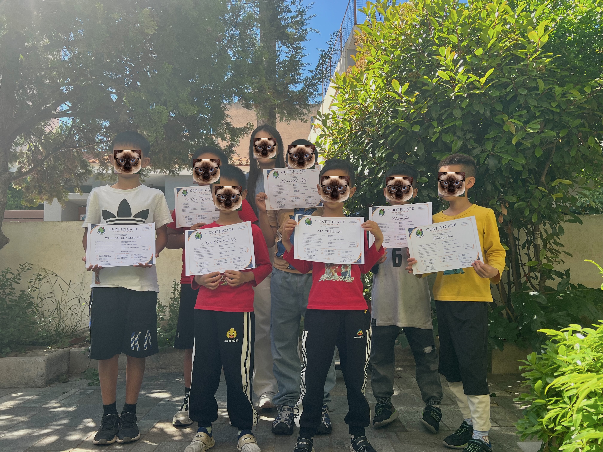
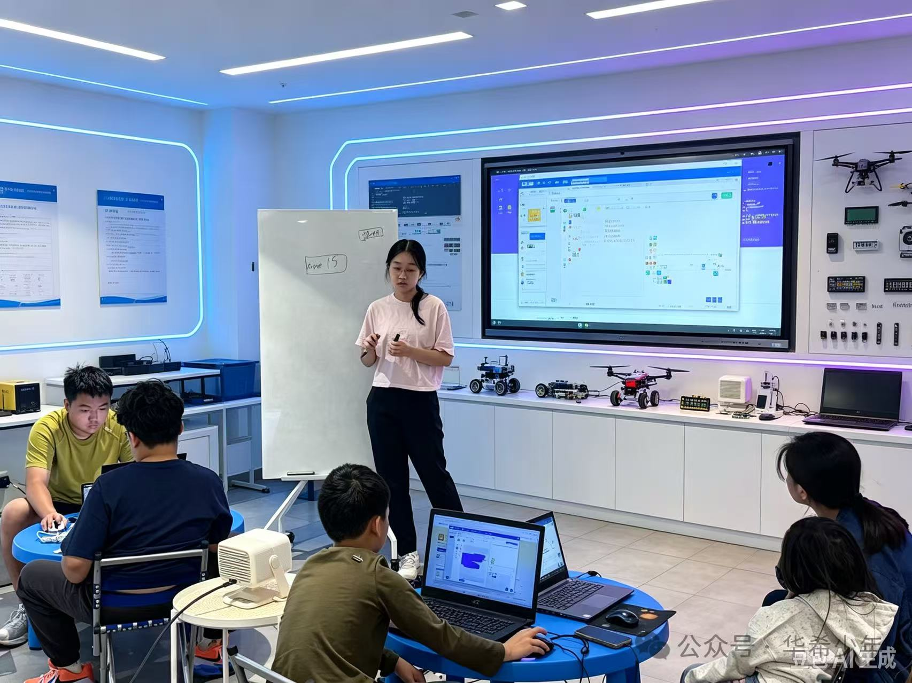

## Course Overview：
A Scratch tutorial courseware aimed at building computational thinking for kids aged 7-10 using visual coding blocks.

## Impact & Milestones：
3 Cohorts Completed: Successfully delivered structured Scratch programming workshops across 3 completed classes for young learners.

Hands-On Creative Learning: Guided children from basic block logic to building interactive stories, animations, and mini-games.

Community-Driven & Free: Open educational resources designed to lower the barrier to introductory computational thinking for kids.

## Learning Moments & Graduation：

